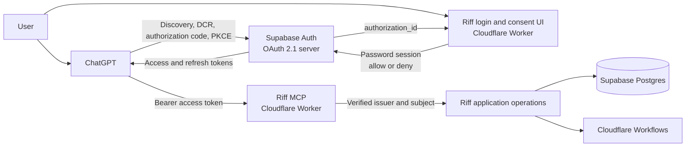

# Riff Supabase Auth and OAuth Cutover Design

- Status: deployed to hosted development; interactive ChatGPT acceptance pending
- Date: 11 October 2026
- Product: Riff
- Runtime: Cloudflare Workers + Workflows
- Identity and database: Supabase Auth + Supabase Postgres

## Decision summary

Riff will remove Auth0 and use the existing Supabase project for both:

- Riff email-and-password accounts; and
- the OAuth 2.1 authorization server ChatGPT uses to connect to Riff's MCP
  server.

Cloudflare remains the application runtime. It continues to host the Riff web
pages, OAuth consent UI, MCP endpoint, MCP Apps UI, and background Workflows.
There will be no Cloudflare Access login in front of Riff's MCP, sign-in, or
consent routes.

This is a greenfield authentication cutover. The owner confirmed that the
preview has no customer accounts worth migrating. Existing database rows will
not be reset, deleted, reassigned, or matched by email. The three current
Auth0-backed preview accounts and their product records will remain stored but
will be inaccessible after the Auth0 verifier is removed. The owner and teammate
will each create a new Supabase account and therefore a new internal Riff
account.

Google and Apple sign-in are a later increment. They are not part of this
cutover.

## Scope and non-goals

This design covers:

- Supabase password signup, email confirmation, sign-in, sign-out, and password
  recovery;
- Supabase OAuth 2.1 for ChatGPT with authorization code and S256 PKCE;
- the Riff-hosted login, consent, account, and recovery pages;
- one durable internal identity for both the website and ChatGPT;
- a one-time welcome followed by the normal Riff Home experience;
- the independently observed MCP connection fixes needed for ChatGPT; and
- a staged Cloudflare deployment with a hard protocol-compatibility gate.

This design does not migrate or merge the existing Auth0 preview identities,
finish every feature in the canonical product happy path, add social providers,
or introduce a second hosting stack.

## Why this design

The current hosted stack is split across Cloudflare, Supabase, and Auth0. Auth0
adds a tenant, clients, secrets, and an OAuth setup path that has already blocked
the ChatGPT connection. Supabase Auth can own password accounts, authorization
codes, PKCE, refresh tokens, dynamic client registration, OIDC discovery, and
asymmetric JWT signing in the project Riff already uses for durable data.

Three approaches were considered:

1. **Keep Auth0.** This preserves current code but does not simplify operation or
   remove the failing setup. Rejected.
2. **Build an OAuth server in the Worker around Supabase passwords.** This gives
   more protocol control but makes Riff responsible for authorization codes,
   refresh-token rotation, registration, grants, and OAuth security. Rejected.
3. **Use Supabase Auth and its OAuth 2.1 server, with Riff hosting login and
   consent.** This keeps identity and token issuance in Supabase while preserving
   the Cloudflare runtime. Chosen with the explicit single-resource audience
   boundary below.

A password grant is not a substitute for OAuth. The browser may show a simple
Riff email/password form, but ChatGPT must use authorization code with S256 PKCE
and must never receive the user's password.

## Verified takeover baseline

The following was rechecked before this design was written:

- Supabase project `fdicggstdtthfpcrpujf` (`kettle`) is linked, active, and
  healthy.
- All five repository migrations are present on the hosted project.
- Supabase OAuth 2.1 Server is currently disabled; its authorization-server
  metadata endpoint returns `feature_disabled`.
- OIDC metadata and JWKS are live. The issuer is
  `https://fdicggstdtthfpcrpujf.supabase.co/auth/v1`, and the current signing key
  is asymmetric.
- The Worker currently discovers Auth0, requires Auth0-specific metadata and
  claims, and uses a website OAuth client ID and secret.
- The database already resolves a verified `(issuer, subject)` pair to an
  internal account. That provider-neutral trust boundary can be reused.
- The live database has only preview identities, and `auth.users` is empty.
- The current MCP also has non-authentication connection defects: ChatGPT-origin
  requests are rejected, preflight is unsupported, some tools lack titles, and
  one error payload violates its declared output schema.

## Target architecture



Cloudflare verifies the Supabase token, derives an internal account only from
the verified issuer and subject, and passes that account to application
operations. Tool input, unverified headers, email addresses, profile URLs,
dynamic-client names, and browser-supplied account IDs never establish
ownership.

## Product behavior

### Password account lifecycle

1. A new user submits email and password on the Riff signup page.
2. Supabase creates the user and sends an email-confirmation link. Confirmation
   remains enabled for the preview; it is not disabled merely to shorten the
   demo.
3. Riff preserves the OAuth transaction in a short-lived, signed, HttpOnly
   transaction cookie. The email callback may resume only that validated
   transaction.
4. After confirmation, the callback exchanges the one-time code, rotates the
   website session, and returns to the pending consent page.
5. A returning user signs in with email and password. Errors are generic enough
   not to disclose whether an account exists.
6. A user who forgets a password can request a recovery email and set a new
   password through a recovery-only session.

Signup and recovery endpoints are rate-limited. CAPTCHA may be enabled in the
Supabase project if automated abuse appears; it is not a substitute for email
confirmation or application rate limits.

### Connecting ChatGPT

1. The user adds the canonical Riff MCP endpoint in ChatGPT with mixed
   authentication.
2. ChatGPT reads Riff protected-resource metadata and the Supabase authorization
   server metadata, then dynamically registers a client.
3. On the first protected action, ChatGPT starts authorization code with S256
   PKCE for the single-purpose Riff Supabase project.
4. Supabase validates the request and sends the browser to the Riff consent page
   with an opaque `authorization_id`.
5. If no website session exists, Riff sends the user through signup or sign-in
   while preserving the transaction.
6. Riff shows the requesting client, its validated callback destination, the
   standard OAuth scopes, and a separate plain-language list of the Riff actions
   being granted. The user explicitly chooses **Allow** or **Deny**.
7. Supabase issues a code. ChatGPT exchanges it for tokens and retries the tool
   with the access token.
8. The first verified website or MCP request creates a fresh internal account
   through the existing issuer/subject resolver. Both surfaces resolve to that
   same account.

### First open and returning open

Only `kettle_diagnostic` remains anonymous. Riff Home, onboarding, account data,
creator analysis, Discovery, and Studio all require the verified Supabase OAuth
identity.

The additive migration adds `onboarding_seen_at` to the internal account. When
the first authenticated `open_riff` observes an empty timestamp, it returns the
welcome experience with Home. After the welcome panel mounts, it calls a
protected, idempotent `mark_riff_onboarding_seen` operation. A later
`open_riff` skips the automatic welcome and opens Home directly. The marking
tool is declared mutating; `open_riff` itself does not pretend that constructing
or sending a response proves the user saw it.

Onboarding state is a routing hint, never a prerequisite for account access. If
reading or stamping `onboarding_seen_at` fails while the authenticated account
state is otherwise available, Riff still renders Home and exposes a secondary
**Show welcome** action. The protected `show_riff_welcome` help action remains
available at any time. If the initial response never renders, the mount callback
does not run and the next open may offer the welcome again.

This state belongs to the internal account, not a browser, ChatGPT conversation,
or OAuth client, so reconnecting does not replay onboarding or lose saved work.

### Existing preview data

Old Auth0 identities and all rows they own remain untouched. Because the owner
chose no migration, new Supabase subjects create new internal accounts and cannot
see those old projects, briefs, creator profiles, jobs, or receipts. If the owner
later reverses this decision, the only safe recovery is an explicit,
reviewed identity-mapping change to a named account. Email matching or automatic
account merging is prohibited.

### Future Google and Apple sign-in

Google or Apple can later be added as Supabase providers on the same sign-in
page. A social identity may reach an existing Riff account only when Supabase has
explicitly linked it to the same existing Supabase user. Riff will never merge
accounts because two providers report the same email address.

## OAuth and token contract

### Two authorization namespaces

Riff separates protocol scopes from application permissions:

- **OAuth scopes** are standard Supabase-supported values sent on the OAuth
  wire. Riff's protected-resource metadata and tool descriptors declare the
  minimal API identity requirement, `openid`. The plugin always adds
  `offline_access` so refresh can be tested and supported. It explicitly
  suppresses provider-default scopes; `profile`, `email`, and `phone` are not
  requested by this release.
- **Riff permissions** are server-issued values in a private
  `riff_permissions` access-token claim. Initial values remain
  `account:read`, `projects:read`, and `projects:write`. Tools authorize against
  these values after token validation.

Custom Riff permissions are never advertised as OAuth scopes, and standard OAuth
scopes are never treated as sufficient permission to run an application
operation. Tests inspect protected-resource metadata, every protected tool
descriptor, and every `WWW-Authenticate` challenge to ensure no unsupported
custom scope leaks onto the OAuth wire.

The consent page explains both layers: it displays the actual standard scopes
requested and separately says that Riff can read the account, read projects and
creator work, and create or update Riff work. A generic `openid` label alone is
not adequate consent copy.

### Discovery and dynamic registration

The Worker publishes protected-resource metadata at both supported Riff paths:

- `/.well-known/oauth-protected-resource`
- `/.well-known/oauth-protected-resource/mcp`

The resource value is the canonical HTTPS MCP URL ending in `/mcp`. The single
authorization server is
`https://fdicggstdtthfpcrpujf.supabase.co/auth/v1`.

Discovery code handles an issuer with a path deliberately. It does not use a
relative-URL expression that drops `/auth/v1`. In particular, the live OIDC
metadata is at `/auth/v1/.well-known/openid-configuration`, while the OAuth
authorization-server metadata for the pathful issuer is at
`/.well-known/oauth-authorization-server/auth/v1`. Fixtures and hosted checks
cover both exact URLs.

Dynamic client registration is the intended ChatGPT flow because it requires no
client ID or secret to be pasted into ChatGPT. The hosted Supabase baseline does
not currently advertise RFC 9207 authorization-response issuer identification,
so the expected redirect is the per-connection
`https://chatgpt.com/connector/oauth/{callback_id}` form. OpenAI also documents
`https://chatgpt.com/connector_platform_oauth_redirect` for issuer-identified
servers. Riff accepts those two exact forms so a metadata/callback-mode change
does not strand an otherwise valid connection; it accepts no other ChatGPT path.

DCR is not an identity guarantee: any software can register a client, and client
names and metadata are untrusted. The Riff consent handler therefore:

- retrieves authorization details directly from Supabase;
- requires the current request's redirect URI to exactly equal a redirect URI
  stored on that Supabase DCR client;
- accepts only a normalized HTTPS URL on the exact `chatgpt.com` origin whose
  path is either `/connector/oauth/` plus one non-empty, bounded, URL-safe
  callback-ID segment or exactly `/connector_platform_oauth_redirect`, with no
  credentials, port, query, fragment, or extra path segment;
- denies unknown redirect destinations rather than presenting an Allow button;
- HTML-escapes all client metadata and never fetches a client-supplied logo or
  URL; and
- always requires interactive consent for a new grant.

The current release does not accept arbitrary `chatgpt.com` paths, and the
provider redirect returned after approval or denial must have the same exact
base callback as the authorization details shown before consent.

The checked-in `plugins/riff/mcp.json` uses the documented OpenAI auth extension
fields under `extensions["com.openai"].auth`:

```json
{
  "type": "mixed",
  "client": { "mode": "dcr" },
  "resource": "<the exact canonical HTTPS Riff MCP URL>",
  "baseScopes": ["openid", "offline_access"],
  "defaultScopes": []
}
```

The empty default override prevents ChatGPT from automatically requesting every
OIDC scope Supabase advertises, which currently also includes `profile`, `email`,
and `phone`. The final file contains the real canonical resource, never the
placeholder shown above, and is validated against the installed plugin schema.
The hosted trace then proves that ChatGPT honors the declared DCR mode, resource,
and exact scope set.

### Access-token hook

An additive migration installs a Supabase Custom Access Token Hook. Current
Supabase OAuth access tokens use the native `authenticated` audience and the
OAuth server does not provide RFC 8707 resource-indicator binding. This project
has exactly one OAuth resource, the canonical Riff MCP. For a token whose trusted
claims contain a persisted OAuth `client_id`, the hook therefore replaces `aud`
with that one canonical MCP URL and adds the private Riff permission set. For
refresh issuance, it detects the persisted `client_id` in the claims rather than
relying only on the authentication-method value, which is different during
refresh.

This is a preview compatibility workaround, not RFC 8707 resource binding and
not proof of OpenAI protocol compliance. Supabase does not carry the requested
`resource` through this flow, so the hook cannot distinguish an omitted, wrong,
or mismatched resource request. Public release remains blocked unless this
limitation is removed upstream or replaced by a standards-compliant
authorization layer.

The hook must preserve all Supabase-required claims. Its SQL function uses a
fixed empty `search_path`, revokes execution from `public`, `anon`, and
`authenticated`, and grants only the execution privilege Supabase's
`supabase_auth_admin` hook runner requires. Ordinary password website sessions
have no OAuth client binding, retain the normal Supabase audience, receive no
Riff permission claim, and cannot be used as MCP credentials.

### Single-resource compatibility boundary

Supabase's current OAuth server does not implement RFC 8707 resource indicators;
its native OAuth access-token audience is `authenticated`. Riff does not weaken
the MCP verifier to accept that generic audience. Instead, this dedicated
preview project has one intended OAuth resource and the trusted token hook
stamps every `client_id`-bearing OAuth token with the exact canonical Riff MCP
audience. This does not prove which resource the client requested. The
consent handler independently permits only the strict ChatGPT callback shape,
and the Worker still requires the exact issuer, audience, OAuth client binding,
role, lifetime, and private permission claim before resolving an account.

This is intentionally a constrained single-resource preview. A second API or a
non-ChatGPT
OAuth client cannot be added to the same Supabase OAuth server by configuration
alone; it requires a new reviewed token-routing design. Hosted acceptance must
prove that authorization-code and refreshed tokens both carry the canonical
audience, `client_id`, and Riff permissions, while ordinary website tokens keep
the native `authenticated` audience and are rejected by MCP.

### Worker validation

Every protected MCP request must pass all of these checks before account
resolution:

- signature against the pinned Supabase issuer's remote JWKS;
- an asymmetric signing algorithm from the explicit allowlist, initially ES256
  and RS256 only, never HS256 or `none`;
- exact issuer;
- exact canonical Riff MCP audience;
- valid `sub`, `iat`, `exp`, and bounded lifetime;
- authenticated user role;
- a valid OAuth `client_id` claim;
- the required server-issued `riff_permissions`; and
- existing local identity-block and token-valid-after checks.

A normal Supabase website token, old Auth0 token, token for another audience,
token from another project, or token missing a required Riff permission fails
closed before any repository call.

Website routes use a separate Supabase-session verifier. It accepts the normal
Supabase `authenticated` audience only for the Riff website, then resolves the
same trusted issuer and subject. A website access token is never forwarded to or
accepted by the MCP verifier.

### Refresh, revocation, and sign-out

Supabase refresh-token rotation remains enabled. A successful refresh must
preserve `iss`, exact MCP `aud`, `client_id`, and `riff_permissions`; replay of a
rotated-out refresh token after the configured reuse interval must fail.
Reconnecting the same Supabase subject must
resolve the same internal account and saved work.

Riff's account page includes a control to revoke the ChatGPT OAuth grant through
Supabase's user-grant mechanism. Revocation must make the associated refresh path
fail and require reconnection. Website sign-out only clears/revokes the website
session; it is intentionally distinct from revoking ChatGPT's OAuth grant.

## Riff-hosted authentication UI

The existing Worker website becomes the branded auth and consent surface. The
first implementation provides:

- `GET /auth/sign-in` and `POST /auth/sign-in`
- `GET /auth/sign-up` and `POST /auth/sign-up`
- `POST /auth/sign-out`
- `GET /auth/callback` for email confirmation and recovery code exchange
- `GET /auth/forgot-password` and `POST /auth/forgot-password`
- `GET /auth/update-password` and `POST /auth/update-password`
- `GET /oauth/consent`
- `POST /oauth/decision`
- `GET /account`
- `POST /account/oauth-grants/:id/revoke`

The pages use the finalized Riff visual system and work independently of the MCP
panel. The Supabase publishable key may be browser-visible; the service-role key
never is. Passwords, tokens, authorization codes, recovery codes, and cookies are
never logged.

Website sessions use Secure, HttpOnly, SameSite cookies. Authentication and
recovery rotate the session identifier. State-changing requests require an
unpredictable CSRF token plus an exact allowed origin. OAuth transaction cookies
are short-lived, single-use, bound to the intended `authorization_id`, and cannot
be replaced with arbitrary redirect URLs. All return targets must resolve to an
allowed Riff path.

The pages emit a restrictive content-security policy including
`frame-ancestors 'none'`, do not load client-supplied remote media, and escape
dynamic values. The consent route validates that the current Supabase user owns
the pending authorization interaction, obtains all details from Supabase, and
submits allow/deny through Supabase. It never constructs or trusts the final
client redirect itself.

## Database behavior and migration safety

There is no account migration and no remote reset.

The provider-neutral `account_identities` table remains authoritative. On first
successful Supabase-authenticated website or MCP access:

1. the verified issuer and Supabase user UUID go to the server-only resolver;
2. the resolver creates exactly one fresh internal account under its existing
   advisory lock; and
3. every later website and ChatGPT request for that subject resolves to the same
   account.

The integration lead allocates one new UTC migration timestamp. Applied history
is never edited. The additive migration:

- installs and locks down the custom access-token hook;
- adds nullable `accounts.onboarding_seen_at`;
- adds the idempotent server-only onboarding-seen operation; and
- updates first-account provisioning from `Kettle member` to `Riff member`
  without rewriting existing accounts.

Before any control-plane change, the lead confirms hosted backup/PITR status and
records pre-change IDs, row counts, and ownership relationships for
`accounts`, `account_identities`, `projects`, `brief_versions`, `write_receipts`,
`creator_profiles`, `creator_scans`, `creator_dna_versions`,
`creator_write_receipts`, `creator_jobs`, `creator_job_events`,
`creator_pipeline_budget`, `creator_pipeline_allowances`,
`creator_provider_trials`, `creator_attempts`, `creator_attempt_receipts`, and
`creator_seed_reviews`. The same report is captured after cutover.

Expected data changes are limited to Supabase auth users/sessions/grants, one new
internal account and identity per tester, and onboarding state on those new
accounts. Existing ownership relationships and product-row counts do not change
except for deliberate test work created through the new accounts.

Service-role RPC access remains server-only. The browser receives only the
publishable key and its own Supabase session. Existing account checks remain
authoritative even if client RLS policies are added later.

## Code and configuration changes

### Authentication package

The provider-neutral verifier boundary remains while Auth0 assumptions are
removed:

- no trailing-slash issuer requirement;
- no required revocation endpoint;
- no `client_secret_post` requirement in discovery;
- no RS256-only or `azp`-only validation;
- no custom OAuth scope parsing as application permission; and
- no Worker-side Auth0 website-client exchange.

The MCP verifier understands the exact Supabase issuer, path-safe discovery,
asymmetric JWKS, `client_id`, exact resource audience, and hook-issued Riff
permissions. The website verifier remains a separate code path with its own
audience rules.

### Worker configuration

The final accepted deployment removes the Auth0-era values:

- `AUTH_ISSUER`
- `AUTH_CLIENT_ID`
- `AUTH_CLIENT_SECRET`
- the old Auth0 session secret

The final runtime uses clearly named configuration for:

- canonical website origin;
- canonical MCP resource URL;
- Supabase project URL;
- Supabase publishable key;
- Supabase service-role key, server-side only;
- Riff auth-cookie/transaction signing secret; and
- the strict ChatGPT callback-URI policy and exact MCP CORS origins.

Provider keys and Cloudflare Workflow bindings are unchanged. Incomplete auth
configuration exposes only `kettle_diagnostic`; it never exposes onboarding or
protected product data.

### MCP and plugin compatibility corrections

The cutover release also:

- handles `OPTIONS /mcp` and permits only configured ChatGPT origins with bounded
  CORS headers;
- gives every tool a human-readable `title`;
- ensures error results never include structured content that violates a success
  output schema;
- preserves a correct `WWW-Authenticate` resource-metadata challenge on HTTP and
  tool authorization failures;
- declares standard OAuth scopes in protected-resource metadata and protected
  tool security schemes, while retaining internal Riff permission checks;
- marks only the diagnostic tool as anonymous and all account/product/onboarding
  tools as OAuth-protected; and
- validates the checked-in plugin package against the installed schema and the
  current ChatGPT add flow.

No wildcard credentialed CORS policy is introduced.

## Supabase control-plane changes

Hosted settings change only after code and tests for the development login and
consent surface are ready:

1. Confirm password sign-in and email confirmation are enabled.
2. Configure the exact Riff website callback/recovery URL.
   Remove broad wildcard redirects.
3. Confirm delivery of confirmation and recovery email; configure production
   SMTP before inviting anyone beyond the two-person preview.
4. Confirm the active asymmetric signing key and JWKS.
5. Apply the additive migration and inspect the installed hook grants before
   enabling it.
6. Enable Supabase OAuth 2.1 Server against the Riff authorization path.
7. Enable dynamic client registration.
8. Verify discovery advertises authorization code, refresh token, S256, the
   registration endpoint, supported standard scopes, and compatible token
   endpoint authentication methods.
9. Enable the access-token hook and prove authorization-code and refresh tokens
   receive the canonical MCP audience and Riff permissions, while password
   sessions retain `authenticated` and no Riff permissions.
10. Only then expose the canonical MCP through the new flow.

Sanitized settings and endpoint metadata may be recorded. Passwords, access
tokens, refresh tokens, authorization codes, service-role keys, cookie secrets,
and client secrets may not be recorded.

## Delivery sequence

The cutover is delivered through the existing development Worker:

1. Capture the pre-change database and backup evidence.
2. Add the protocol probes and fixtures for pathful Supabase discovery, DCR,
   PKCE, exact scopes, resource binding, token claims, refresh, and rejection
   cases.
3. Implement the secure surface needed to authenticate, inspect a Supabase
   authorization interaction, and allow or deny it. Add the verifier and token
   hook.
4. Add the integration-lead-owned append-only migration; never edit applied
   history and never reset the hosted database.
5. Deploy the tested Worker, enable Supabase OAuth and DCR, enable the token hook,
   then exercise authorization code, refresh, password-session separation, and
   exact MCP audience checks.
6. If hosted OAuth discovery or token issuance fails, keep product operations
   protected and repair the auth configuration before inviting another user.
7. Implement the complete Riff signup, confirmation, sign-in, recovery, consent,
   account, grant-revocation, onboarding, and website-session experience.
8. Correct MCP CORS, titles, security schemes, challenges, schema-safe errors,
   and the explicit plugin auth configuration.
9. Run the complete repository check, local Worker dry run, and a real ChatGPT
   development install covering the password lifecycle, consent, protected tools,
   refresh, revoke, reconnect, and account isolation.
10. Repeat hosted acceptance and capture the post-change database report.
11. Only after acceptance, remove Auth0 code, Cloudflare secrets, and
    active setup documentation. Record the Auth0 decision as superseded.

## Verification

### Automated tests

The implementation must cover at least:

- exact Supabase discovery URLs for an issuer with `/auth/v1` and no trailing
  slash;
- ES256/RS256 verification and rejection of HS256 and unsigned tokens;
- exact MCP audience acceptance and rejection of `aud: authenticated` alone;
- required OAuth `client_id` and server-issued Riff permissions;
- expired, future-issued, overlong, wrong-issuer, wrong-project,
  wrong-audience, and tampered tokens;
- separation of standard OAuth scopes from internal permissions in metadata,
  tool descriptors, challenges, and operation checks;
- access-token hook behavior during authorization-code issuance and refresh,
  including canonical audience binding, permission addition, and unchanged
  ordinary website tokens;
- first-login account provisioning under concurrency;
- `/account` and `get_account_state` resolving the same internal account;
- rejection of account IDs or emails injected through tool or form input;
- signup, confirmation, sign-in, sign-out, forgot-password, update-password,
  expired recovery, and preserved consent return paths;
- session rotation, CSRF, origin, exact DCR-client redirect binding, strict
  ChatGPT callback-shape validation, metadata escaping, CSP, and open-redirect
  rejection;
- consent allow, deny, unknown callback, invalid, expired, and already-decided
  states;
- first-open welcome, post-mount idempotent marking, returning Home, and
  reconnect behavior;
- lost first responses, onboarding-state read failures, and onboarding-state
  write failures, all of which must leave authenticated Home usable with a
  secondary protected Welcome action;
- refresh rotation, replay failure, grant revocation, and the distinction between
  website sign-out and OAuth revocation;
- ChatGPT-origin MCP preflight and POST handling;
- protected-resource metadata and authorization challenges;
- titles and valid success/error output shapes for every tool; and
- rejection of old Auth0 credentials after cutover.

`npm run check` must pass before any canonical deployment.

### Hosted protocol gate

The development deployment must demonstrate:

1. Supabase OAuth metadata returns 200 and advertises DCR and S256.
2. ChatGPT registration succeeds without manually entered client credentials.
3. The observed authorization flow uses the scope set `{openid,
   offline_access}`, matching the plugin configuration.
4. A normal `aud: authenticated` website token fails at the MCP boundary.
5. The OAuth access token has exact issuer, MCP audience, OAuth client ID, and Riff
   permissions.
6. A password token retains the native audience and has no Riff permissions.
7. Refresh preserves the OAuth-token properties, rotated-token replay after the
   configured reuse interval fails, and grant revocation prevents further
   refresh.

Failure of any item stops the cutover.

### Canonical hosted acceptance

After the protocol gate passes, the cutover is complete only when all of these
are observed on the canonical services:

1. ChatGPT adds the mixed-auth Riff MCP without manual OAuth credentials.
2. A new user signs up with a password, confirms the email, signs in, and
   explicitly allows the disclosed Riff access.
3. `/account` and `get_account_state` return the same fresh internal account.
4. First `open_riff` shows Welcome plus Home; the mounted panel records the seen
   state and a later open goes directly to Home.
5. A protected creator operation can read only that account's state.
6. Refresh and reconnect preserve the same account, onboarding status, and saved
   work rather than creating another account.
7. Password recovery succeeds; an expired or reused recovery link fails safely.
8. OAuth grant revocation requires ChatGPT reconnection, while website sign-out
   does not silently revoke the ChatGPT grant.
9. A second test account cannot read, mutate, render, or infer the first account's
   records.
10. Website tokens, old Auth0 tokens, and tokens with a wrong resource are
    rejected by the MCP.
11. Cloudflare no longer contains the Auth0 issuer, client ID, client secret, or
    old session secret.
12. The pre/post data report proves no existing product row was reset,
    reassigned, or destructively rewritten.
13. In a controlled onboarding-state failure check, authenticated Home remains
    usable and offers the protected Welcome action without exposing another
    account's data.

## Rollout and rollback

The development deployment keeps the old Auth0 Cloudflare secrets until
Supabase passes protocol and end-to-end acceptance. Failure at that stage means
disabling the Supabase OAuth entry point or rolling the Worker forward to the
last known working version while repairing configuration; database changes are
additive and remain intact.

After canonical Supabase acceptance, Auth0 code and secrets are deliberately
removed. At that point an old Cloudflare deployment is not a one-click rollback,
because its required secrets no longer exist. The normal response is a forward
repair or a rollback to the most recent Supabase-auth Worker version. Restoring
Auth0 would require intentionally restoring both code and secrets and is an
owner-approved emergency operation, not an automatic fallback. Supabase product
data remains unchanged throughout.

## Release boundary

Passing this design's acceptance list proves the authentication cutover,
first-open routing, and a protected creator operation. It does not by itself
claim the complete Riff product is finished. The full creator video input,
analysis, Discovery, and Studio happy path in the canonical `PRODUCT.md` remains
a separate release gate and must be verified end to end before a product-launch
claim.

## Documentation sources

- [OpenAI plugin authentication](https://developers.openai.com/plugins/build/auth)
- [OpenAI plugin packaging and auth manifest fields](https://developers.openai.com/plugins/build/plugins)
- [Supabase OAuth 2.1 Server getting started](https://supabase.com/docs/guides/auth/oauth-server/getting-started)
- [Supabase MCP authentication](https://supabase.com/docs/guides/auth/oauth-server/mcp-authentication)
- [Supabase OAuth flows](https://supabase.com/docs/guides/auth/oauth-server/oauth-flows)
- [Supabase token security and custom claims](https://supabase.com/docs/guides/auth/oauth-server/token-security)
- [Supabase custom access-token hook](https://supabase.com/docs/guides/auth/auth-hooks/custom-access-token-hook)
- [Supabase authorization resource handling](https://github.com/supabase/auth/blob/master/internal/api/oauthserver/authorize.go)
